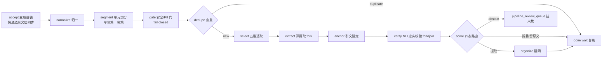

# 01 需求与业务原理（_01_business）

> 状态：confirmed　更新：2026-09-27
> 来源：`business/02_产品设计.md` v0.7（权威裁定）、`business/01_设计原理.md` v0.7、`business/业务层_闭源/`、`business/产品宣传说明书.html`、`business/产品宣传说明书_反向检查报告.md`。冲突处置见 `_02_principle/02_conflict_analysis.md`。

## 1. 需求背景

AI 时代最大的浪费是"你说过的话，AI 从来没有记住"：跨会话失忆、大海捞针、数据孤岛、机会靠运气。大模型越来越聪明，但每次对话从零开始——偏好、经历、正在寻找的东西散落在无数会话里。

MetaMemory 定位为**模型无关、跨平台中立的记忆中间层**（所有 AI Agent 的"海马体"与"外脑"），以及在此之上生长的意图撮合网络。价值单位不是"记住了什么"，而是"**用户能知道什么**"：

```
你该知道的 = 你的过去（记忆）× 相关的他人（授权）× 相关的世界（信息流）
```

**系统公理（全产品有效，见 _02 原理档）**：
- 公理 0 信息即服务：组织每个域的"我的信息"，派生"我需要的"（意图）与"我能提供的"（供给）；
- 公理 1 只有"域"一种主体，角色差异一律转化为属性与信誉；
- 公理 3 视野不是权限，是知晓边界（六档 = L1–L5 + 定向变体 L3·D，N1 裁定）；
- 公理 4 升档需确认、降档即生效、派生不越权（三不越权）；
- 公理 7 写免费读收费，关于自己永远免费。

**架构裁定（ADR 14/15/16，见 _03）**：核心层只做两件事——**接收信息（add）与查询信息（search）**；纠错/遗忘是写侧治理，置信/溯源是查询出口语义，视野裁决/审计/计量是不可拆横切；网络即搜索（无独立网络 API）；业务层只经 add/search 消费核心层（import-linter 技术强制）。

## 2. 目标与非目标

| 类型 | 内容 |
|---|---|
| 目标 In | ① 核心层收发协议（add/search/context/manage 四动词 + 精确验证模式 + grep 兼容输出）；② 快通道原文层同步落袋 <100ms；③ 视野六档裁决 + 授权三元组（视野×目的×时效）+ 公开层目的闸（G1 提级必做）；④ 命题化提取 + 引文锚定 + NLI 忠实校验 + 四态路由（含 abstain）；⑤ 五路检索融合 + 检索意图三分；⑥ 双时态知识更新（supersedes 不删除）；⑦ 意图双入口（声明直生效 / Agent 只产候选）；⑧ 认知简报（晨报/周刊，业务层）；⑨ 三层两仓交付（lite 档本地全闭环） |
| 非目标 Out | 跨域删除传播（仅最小形态：源头失效+已知下游通知）；女巫攻击防护；家庭域（宣传页标"即将上线"）；推广营销执行；基础大模型研发；前端 ChatBot；完全的第三方权利义务体系；完全 Agent 侧行为信誉体系（仅基线版随 S3） |

## 3. 用户故事

```text
US-1 作为个人用户，我希望 AI 记住我说的每句话并带出处可纠错，以便跨会话不失忆。
US-2 作为个人用户，我希望每天收到 30 秒晨报（该想起的/没意识到的/与我相关），以便不错过该知道的事。
US-3 作为个人用户，我希望声明意图后机会主动找我，以便不用到处搜寻。
US-4 作为 Agent 开发者，我希望用 add/search 两动词接入记忆能力，以便零成本获得跨会话记忆。
US-5 作为组织 Admin，我希望员工的组织记忆按角色/档位可见并可审计，以便知识沉淀而不越权。
US-6 作为被检索方，我希望"被知晓什么"由我按档位与目的决定，以便隐私可控且被撮合时获益。
US-7 作为合规负责人，我希望授权/裁决/审计全量留痕且不可篡改，以便通过 PIPL/GDPR 审查。
US-8 作为开源用户，我希望 lite 档单容器本地全闭环，以便数据不出设备先用起来。
```

## 4. 业务流程

**接收（ingest，任务式流水线）**：



**查询（recall/express，同步读路径不经编排）**：五路并行召回 → RRF 融合 → rerank → 置信×强度 → VisionArbiter 统一裁决（含公开层目的闸）→ Token 预算内组装 + 溯源引用。

**撮合（业务层，全部是 add/search 的消费方）**：检索到供给（L4，目的闸通过）→ 发起请求（add 事件）→ 机会收件箱 → 相互解锁（视野变更）→ 标记成交/不合适（add 履约事件）。

## 5. 领域概念表

完整词条见 `_01_business/02_domain_concepts.md` 与 `_09_project_dict.json`（一物一名，含禁用别名）。

## 6. 边界与异常场景

| 场景 | 触发条件 | 期望行为 |
|---|---|---|
| 快通道失败 | 原文层落袋写超时/拒绝 | 受理返回失败，不产生"已记住"错觉；落袋类同步写永不拒绝（水位保护豁免） |
| 引文锚定失败 | 提取候选无法定位原文 span | 拒绝入库转复核队列（不静默），无引文不记忆 |
| NLI 判定矛盾 | 忠实校验三态=contradiction 或置信不定 | 原子按低置信隔离，不进 L4/简报/撮合 |
| 提取四态把握不足 | score.route 置信低于阈值 | 显式 abstain 挂 pipeline_review_queue（禁默认落置） |
| 冲突真矛盾 | 同实体同谓词且非时间演进/粒度差异 | 冲突卡片挂起人裁，挂起期不参与 L4/撮合/简报 |
| 跨租户读取 | 个人域记忆被组织查询 | RLS 硬拦（不靠业务裁决），审计留痕 |
| 撤回已共享上下文 | 用户撤回授权 | 停止未来检索；已进入对方会话的上下文界面明示无法追回 |
| 目的不匹配 | 查询者声明目的 ∉ 发布者允许目的集 | 公开条目不入结果集（目的闸，裁决谓词非记录项） |
| 意图到期 | 有效期到期 | 自动转已过期 → 退出发现索引 → 血缘下游级联撤下 → 遗忘管道 |
| 注入攻击 | 段落被判定疑似注入 | 提取产物强制 S3 以下置信 + 视野默认 L1 + 禁自动升档；安全/PII 门 fail-closed 只能收紧 |
| lite 档重排缺席 | 部署档无 reranker | 融合排序退 RRF 直出（降级矩阵，性能降级语义不变） |
| 编排不可判定 | 自动裁决链任一级无把握 | 显式 abstain 挂人裁，禁止默认值兜底（图编译期校验强制） |

## 7. 验收标准（EARS）

```text
WHEN 调用方提交记忆事件（add） THE SYSTEM SHALL 同事务落袋原文层并返回 202 + task_id + SSE 订阅地址，原文 <100ms 可检索。
WHEN 查询者发起 search THE SYSTEM SHALL 以 key 即查询者身份经统一裁决器返回结果集，每条携带置信标注与 {memory_id, span} 溯源。
WHEN 任何读取路径执行 THE SYSTEM SHALL 唯一经过 VisionArbiter（无特殊通道），裁决放行写审计流。
WHEN 提取产物缺少引文锚点 THE SYSTEM SHALL 拒绝入库并转复核队列。
WHEN 自动裁决任一级无法判定 THE SYSTEM SHALL 显式 abstain 挂人裁（禁默认值兜底）。
WHEN 派生内容生成 THE SYSTEM SHALL 视野取 min(来源)（L4 发布投影为唯一合法例外，四道防线补偿）。
WHEN Agent 捕捉到疑似意图 THE SYSTEM SHALL 只产候选（默认仅自己可见），经确认卡片后才可能被发现。
WHEN L4/L5 公开面被检索 THE SYSTEM SHALL 按"发布者允许目的集 × 查询者声明目的"匹配放行。
WHILE 意图处于生效中 THE SYSTEM SHALL 按可见性档位参与发现网络；免费档发现位配额 = 3（意图本体不限量）。
WHILE 记忆处于低置信 THE SYSTEM SHALL 可检索带显著标注且不参与 L4/简报/撮合信号。
WHEN 用户请求硬遗忘 THE SYSTEM SHALL 物理删除 + 血缘级联 + 审计留痕（唯一真删除）；灰色遗忘降权可恢复。
WHEN 崩溃/节点被杀 THE SYSTEM SHALL 经租约判死重派 + 检查点游标续跑，任务零丢失、幂等重放不重复付费。
```

## 8. 未决问题

| 问题 | 影响 | 状态 |
|---|---|---|
| 机会收件箱排序与防骚扰细则 | 业务层 S3 | open（owner=产品负责人，复审 2026-12-24） |
| 初识对话脚本（Day 0） | 冷启动体验 | open（同上） |
| 意图确认卡片交互细节 | 确认链 UX | open（同上） |
| 信誉算法冷启动参数 | 业务层二期 | open（同上） |
| 跨国合规差异（数据出境） | 组织域 SaaS | open（同上） |
| 数字遗产与未成年人细则 | 遗忘/视野策略 | open（同上） |
| 巩固收益门/切分/前置层阈值 | 演化参数（提案值） | open（按 §7.2 基准对账演化；LongMemEval/LoCoMo 无中文对话，中文基准待补） |
| ~~宣传页景气指数徽标口径~~ | 营销一致性 | **resolved（2026-09-27 用户确认）**：徽标已改"业务层二期立项（S3 后）"；处置记录见 _10 chg-002 |
