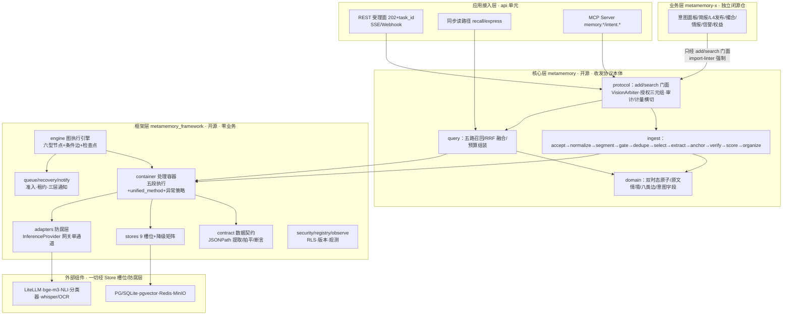

# 01 架构与模块职责（_04_framework_design）

> 状态：confirmed　更新：2026-09-27
> 来源：`business/框架层_开源/1_框架设计.md` v0.5（A1-A15）、`2_框架详细设计.md` v0.1（模块划分）、`business/核心层_开源/3_核心层功能实现.md` §九（工程形态）、`business/README.md`（三层总纲）。签名修正遵循 ADR-001。

## 1. 分层架构图

依赖方向单向自上而下：x → core → framework → 外部组件；禁止反向依赖与循环依赖（import-linter 四重规则 CI 阻断）。

## 2. 模块职责表

| 模块 | 层 | 职责 | 对应 _01 需求 | 对外暴露（见 _06） |
|---|---|---|---|---|
| framework.container | 框架 | 六段签名装饰器、AOP 进出入计时、容器五段执行 runner、异常策略引擎（abstain 一等） | 全部（运行时底座） | unified_method、run_step、PolicyEngine |
| framework.contract | 框架 | JSONPath 提取/拍平、字段断言（confidence 软信号契约） | 全部（模块解耦） | extract_by_mappings、flatten_by_mappings、assert_fields |
| framework.engine | 框架 | 流程图模型与编译校验（六型节点/五关）、lite 内嵌执行器 | US-1（管道） | validate_graph、GraphExecutor |
| framework.stores | 框架 | Store 9 槽位 Protocol + 内存降级实现 | US-8（lite 全闭环） | 9 个 Protocol + fallbacks |
| framework.adapters | 框架 | InferenceProvider 网关单通道（OpenAI 兼容 HTTP，ADR-006 无降级） | 全部（模型无关） | GatewayProvider |
| framework.security/registry/observe/queue/recovery/notify | 框架 | 租户 contextvar/步骤注册表/观测门面/准入/租约/三层通知 | US-7（审计）、US-8 | TenantCtx、StepRegistry、Metrics |
| core.protocol | 核心 | add/search 门面（import 白名单唯一入口）、VisionArbiter（粗筛+精裁+目的闸）、授权三元组、计量闸门 | US-2/4/5/6/7 | protocol.add/search；Arbiter.decide |
| core.ingest | 核心 | 接收管道容器族（快通道/切分/门禁/查重/选取/提取/锚定/校验/四态/建网） | US-1/7 | 管道步骤注册名（ingest.*） |
| core.query | 核心 | 五路召回骨架、RRF 融合、rerank 降档、预算组装 express、精确验证模式 | US-1/2 | query.recall/express |
| core.domain | 核心 | 双时态原子/原文情境/segments/八类边/意图字段数据模型 | 全部 | dataclass/pydantic 模型 |
| api | 应用 | REST 受理（202+task_id+SSE 订阅）、读路径挂载、MCP 骨架（豁免六段签名） | US-1/4 | HTTP/MCP 契约 |
| 业务层 x（另行立项） | 业务 | 只经 add/search 门面消费；行为以记忆事件回流 | US-2/3/6 | 不在本仓 |

**框架职责封闭集合（A13 九项 + 安全基线第 10 项）**：注册组件容器/编排组件容器/接收请求作为任务/管理任务执行环境/重启节点任务不中断/流程监控/组件容器升级/组件配置/组件编排配置/安全基线（DEK/KEK 密钥两层+轮转、审计自身治理、备份演练）。**负空间**：不含业务语义/同步读路径业务逻辑/数据建模/权限裁决/外部组件直连。

## 3. 依赖规则

- 禁止反向依赖与循环依赖；import 方向唯一：`metamemory_x → metamemory(protocol 门面) → metamemory_framework → 外部组件`；
- 业务层（x）steps 只许 import `metamemory.protocol` 的 add/search 门面，禁 import core.ingest/query 内部、Store 槽位、VisionArbiter 之外的读取面（ADR 16 技术强制）；
- 跨模块调用必须走 _06 定义的接口；数据契约层面不 import 上游类型（ADR-005）；
- `algorithm` 方法集中 common（本骨架：framework.contract/engine 纯计算件 + core.query 融合算子）。

## 4. 公共机制

| 机制 | 方案 | 说明 |
|---|---|---|
| 配置 | pydantic-settings（骨架期 dataclass+env） | 档位 profile：full/lite/minimal |
| 日志 | Metrics 门面统一收集（分级+结构化字段），业务禁 console/print | 进出入日志由 unified_method 自动写 |
| 异常 | 错误类型×处置策略表（策略即数据）+ 错误码体系（见 _06/01 §4） | Undecidable→abstain；兜底→死信+告警 |
| 追踪 | OTel：task_id 根 span、节点为 span 链；六段签名的 metrics/evolution 为落地点 | 业务零打点代码 |
| 事务 | 入队与业务写入同事务（Outbox 免除）；节点完成=原子提交（输出+状态推进+后继激活） | PG SKIP LOCKED；lite 档 CAS |
| 密钥 | DEK/KEK 两层，key_version 轮转，惰性重加密 | 敏感字段 AES-GCM |
| 审计 | append-only 月分区 + prev_hash 链式防篡改；审计访问写二级流 | 全量不采样 |
