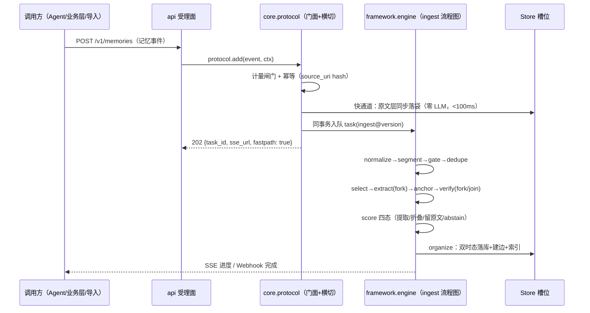
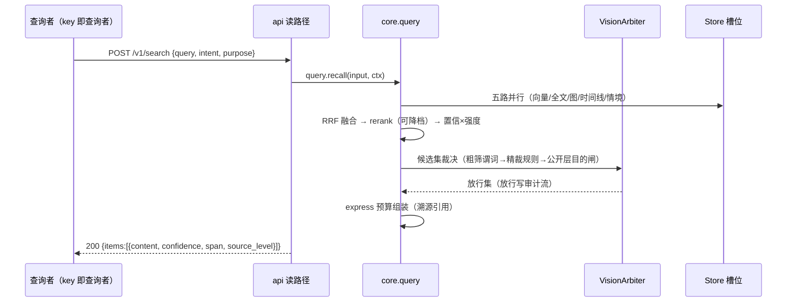

# 02 数据流与调用流（_04_framework_design）

> 状态：confirmed　更新：2026-09-27

## 1. 核心数据流：接收（add）



## 2. 核心数据流：查询（search）



## 3. 主调用链（节点标注：方法名 · 层 · 模块）

```text
[US-1 接收] API handler(豁免) → protocol.add(orchestration·protocol)
  → fastpath_store(data·ingest) → engine 派发 ingest 流程图
  → segment_units(data·ingest) → pre_gate(data·ingest) → dedupe_route(data·ingest)
  → select_worthiness(data·ingest) → [extract_deep(orchestration·ingest)
      → anchor_span(algorithm·ingest) → verify_entailment(data·ingest)]
  → route_score(data·ingest, 四态含 abstain) → organize_links(orchestration·ingest)

[US-1 查询] API handler(豁免) → protocol_search(orchestration·protocol)
  → query_recall(orchestration·query) → rrf_fuse(algorithm·query)
  → arbiter_decide(orchestration·protocol，内含 purpose_gate data·protocol)
  → budget_pack(algorithm·query)

[US-8 框架] run_step(orchestration·container) → extract_by_mappings(data·contract)
  → flatten_by_mappings(data·contract) → resolve_policy(data·container)
  → validate_graph(orchestration·engine)
```

## 4. 数据模型概览

| 实体 | 关键字段 | 存储 | 归属模块 |
|---|---|---|---|
| tenants | plan/quotas/dek_key_version | PG（RLS 根） | 框架 |
| tasks/task_steps | 流程版本/优先级/检查点/租约/abstain_reason | PG SKIP LOCKED | 框架 |
| memory_episodes | 原文/来源/说话人/话题/时间/切分引用 | PG FTS+原文块向量 | core.ingest |
| segments | span/边界依据/切分参数版本 | PG | core.ingest |
| memory_entries | 双时态组/supersedes/引文 span/provenance/视野/强度/embedding | PG+pgvector | core.domain |
| association_edges | 八类/权重/置信/依据/双时态（血缘=type='derived'） | PG 邻接表 | core.domain |
| intent_details | 状态机位/三旋钮/来源 | PG | core.domain |
| published_items | 层级/来源引用/审阅状态/撤回窗 | PG | core.protocol |
| authorization_records | 主体/客体/档位/目的/允许目的集/TTL/状态 | PG | core.protocol |
| pipeline_review_queue | 引用/原因码/重试状态 | PG | 框架 |
| audit_log/metering_events | 月分区/prev_hash/维度量 | PG 分区 | 框架 |

完整 schema 见 _06/02 §3。

## 5. 数据流不变式

1. 原文层全量保底永不删除（硬遗忘为唯一真删除，走审计级联）；
2. 提取与压缩密度分层：原文 → 原子 → 模式，证据永远可回溯；
3. 视野过滤在业务加工之前（过滤前不做业务加工）；
4. 双指标分离：存储完备率（写侧）与检索召回率（读侧基准对账）不得互相伪装；
5. 检索命中重置强度 Δt 并开启 72h 再巩固窗口；窗口外 supersedes 走派生门禁。

## 6. 容量与扩展假设

- 基准假设：单用户日均 200 记忆事件 / 50 原子 / 20 检索；PG 五路索引、审计分区、计量事件的写入放大每季度重估；
- lite 档资源账：嵌入推理档 <4GB 内存/<6GB 磁盘/首启动 <60s（S1 实测回填，超限砍模型件不放宽上限）；
- 演进触发：向量 >5000 万或语义 P99 >200ms → Qdrant/Milvus；多跳 P99 >500ms → 图库；吞吐 >万级/秒 → Kafka；自研编排器 → Temporal（详见选型档 §七）。
